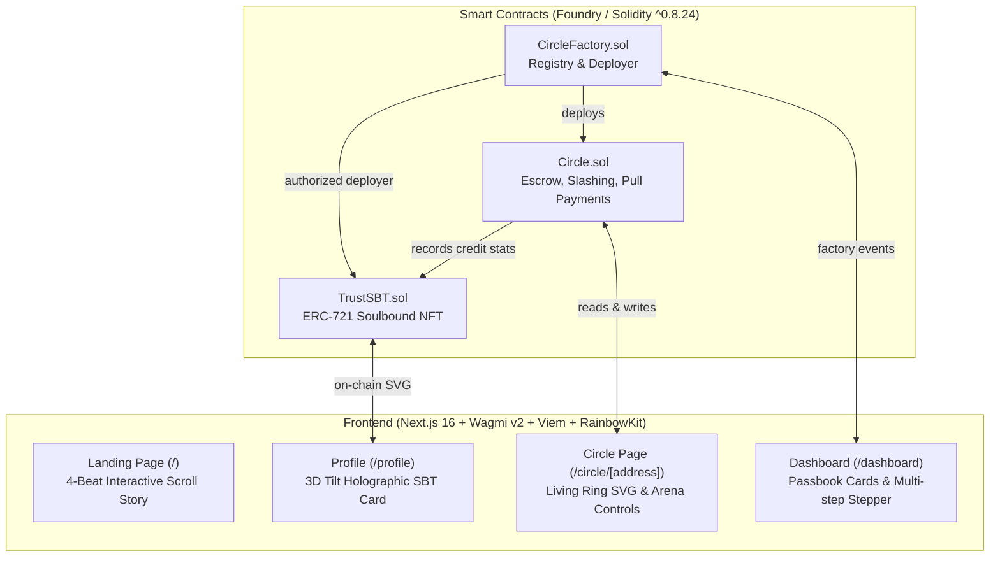

# Bhishi.eth (बीशी) — Trustless Chit-Fund Committees on Ethereum

> **"Panchayat on chain. Bachat bina organizer."**  
> Replace WhatsApp chaos and runaway organizers with trustless smart contracts on Ethereum Sepolia. Build verifiable on-chain financial reputation through soulbound Trust Score NFTs.

---

## 🌟 What is Bhishi?

**Bhishi** (also known as Chit Fund, ROSCA, Committee, or Tanda across South Asia and Latin America) is a community savings vehicle where $N$ members pool a fixed sum each round. One member wins the entire pot each round, until every member has won once.

Traditional chit funds suffer from two fatal vulnerabilities:
1. **The Runaway Organizer**: The committee leader collects the pot and vanishes.
2. **The "Win & Ghost" Defaulter**: An early winner receives a massive pot, stops contributing to future rounds, and disappears.

**Bhishi.eth solves both completely on-chain:**
- 🛡️ **Zero Trusted Organizer**: Smart contracts autonomously enforce deadlines, collect funds, conduct pseudo-random draws via `prevrandao`, and distribute winnings.
- 🔒 **Collateral Escrow & Slashing**: Members lock 1x round contribution upfront as collateral. If a member misses a deadline, their collateral is slashed to fill the pot, and a default is permanently recorded.
- ⏳ **30% Early-Winner Holdback**: When early winners claim, 30% of their winnings is held in trust until the entire circle finishes, disincentivizing ghosting.
- 💎 **Soulbound Trust Score NFT (`TrustSBT`)**: Non-transferable ERC-721 token that computes your portable reputation directly on-chain (+10 pts per on-time payment, +50 pts per completed circle, -50 pts per default).

---

## 🏗️ Architecture



---

## 🚀 Quickstart

### 1. Smart Contracts (Foundry)

```bash
cd bhishi/contracts

# Run comprehensive test suite (28 passing tests)
forge test -vv

# Deploy to Sepolia (PowerShell)
.\deploy.ps1 -RpcUrl $env:SEPOLIA_RPC_URL -PrivateKey $env:PRIVATE_KEY -EtherscanApiKey $env:ETHERSCAN_API_KEY

# Or using Bash
chmod +x deploy.sh && ./deploy.sh
```

### 2. Frontend (Next.js 16 App Router)

```bash
cd bhishi/frontend

# Install dependencies (already prepared)
npm install

# Start local development server
npm run dev
```

Visit [http://localhost:3000](http://localhost:3000) to interact with Bhishi.eth!

---

## 🎨 Design Philosophy: Neo-Desi Aesthetic

- **Color Palette**: 
  - `Paper (#F6F0E4)` — Aged bond paper texture
  - `Turmeric / Haldi (#F2A900)` — Prosperity & auspicious savings
  - `Marigold / Genda (#E8752A)` — Energy & celebratory pot wins
  - `Sindoor (#C1291B)` — Urgent alerts & slashed collateral
  - `Tulsi (#2D7A4F)` — Safe on-time deposits & positive reputation
  - `Charcoal Ink (#15120E)` — Sharp contrast and brutalist borders
- **Typography**: 
  - Display: **Fraunces** (antique editorial serif)
  - UI: **Inter Tight** (clean financial legibility)
  - Data / Addresses: **JetBrains Mono**
- **NeoPop Physics**: Hard shadows (`4px 4px 0 #15120E`), tactile stamps (`OPEN`, `RUNNING`, `DONE`), and smooth interactive SVG animations.

---

## 🧪 Security & Invariant Tests

All 28 unit and fuzz tests pass:
- ✅ **Happy Path**: 2, 3, and 5-member complete circles
- ✅ **Collateral Slashing**: Defaulters get collateral slashed to fill pot
- ✅ **All-Defaulter Recovery**: Safe termination and refund mechanics
- ✅ **Early Settlement**: Instant trigger when all members deposit before deadline
- ✅ **Reentrancy Protection**: ReentrancyGuard on `claim()` pull-payment
- ✅ **Soulbound Enforced**: `TrustSBT._update` blocks all transfers and approvals
- ✅ **Holdback Release**: 30% withheld from early winners is securely released at circle completion

---

## 📜 Verified Contracts (Sepolia)

| Contract | Description |
|---|---|
| `CircleFactory.sol` | Circle deployer & master registry |
| `Circle.sol` | Core escrow, round timer, prevrandao PRNG draw |
| `TrustSBT.sol` | Soulbound NFT with on-chain SVG generation |

---

Developed for Devcon Hackathon.
